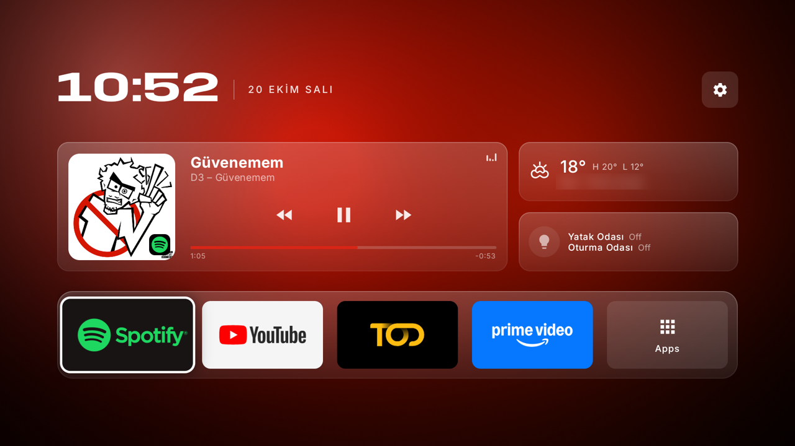
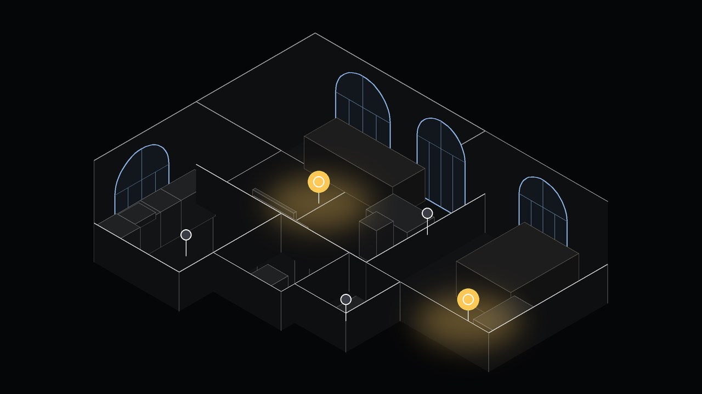
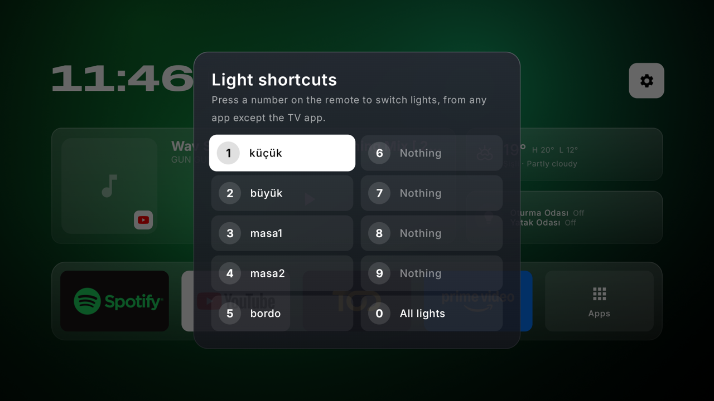
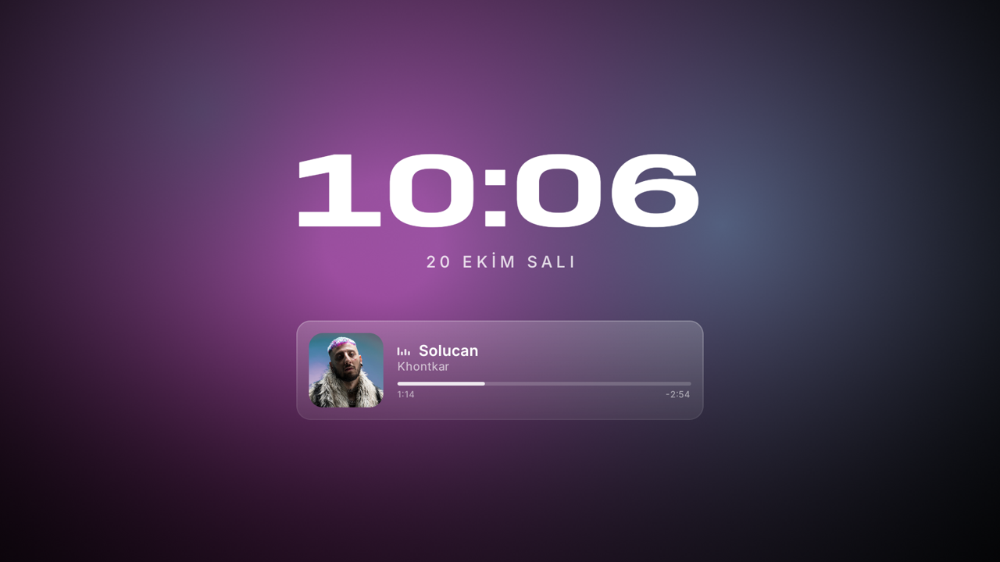

# Falcon Launcher

A custom home screen for Google TV, built for a **TCL / iFFALCON 55U95A** (Android TV 14) but usable on
most Google TV sets. Minimal, Apple TV–inspired, and fast on a modest TV chip. It brings live music, weather,
WiZ smart lights on an isometric 3D floor plan of your home, and remote-control superpowers.



## Features

**Home screen**
- One centered page, no scrolling: a wide clock, Now Playing, weather, lights, and a dock with an **Apps** tile
  for everything else (with search).
- A live background that takes its colors from the **album art** of what's playing, or from the focused app.
  It's drawn by a tiny OpenGL shader in its own layer, so the UI never redraws for it.
- **Now Playing** in the style of macOS's widget: artwork with the app's badge, title, "Artist – Album",
  equalizer, transport controls and a live progress bar. Works with Spotify, YouTube and any app with a
  media session, and remembers the **last played** item when the app is closed.
- Glass cards, Inter for text and Anybody Wide for the clock.

**Lights (WiZ)**
- An **isometric 3D floor plan** of your home (from a [PlanStudio](https://github.com/y4z1c1/planstudio) scan):
  dollhouse cutaway walls, arched windows, and simple models of your furniture.
- Lamps glow on the floor **in real time**. The D-pad moves between lamps, and the camera glides into each room.
- Place lamps on the plan with the remote. Their room follows from where you put them.
- A reliable local WiZ connection: lamps **push** their state changes (including from Google Home), commands
  are acknowledged and retried, and unreachable lamps are shown as such.



**Remote control**
- **Home** opens Falcon (Google TV's own home never flashes up).
- **Hold Home** for the app switcher: recent apps as cards over what's on screen. OK switches, **Up** closes an
  app for good (handy when one hangs). Closing goes through the TV's own network debugging; the first time, the
  TV asks to allow Falcon: choose *Always allow*.
- **TV** switches to HDMI 1 (e.g. a cable receiver) instead of the tuner app.
- **Number keys** switch lamps, rooms or all lights from any app (configurable in Settings › Light shortcuts).
- **Color keys** are picture-mode presets (TCL): hold for 2 s to save the current mode, press to recall.

**Call muting (iPhone)**
- The moment your iPhone rings, the TV pauses what's playing and mutes, and stays that way through any call,
  incoming or outgoing. When you hang up or miss the call, the sound comes back and playback continues
  (anything you'd paused or muted yourself stays that way).
- It works over Bluetooth LE, the way smartwatches get iPhone notifications (Apple's ANCS). Only call
  events are read, never notification content. No app or Shortcut is needed on the phone.



**Screensaver**
- A screensaver (Android "dream") with the clock and Now Playing over the album-art glow, drifting slightly
  against burn-in.



## Requirements

- A Google TV / Android TV 11+ device (developed on Android TV 14). The TCL-specific parts (picture modes,
  the TV key code, auto-start permission) quietly do nothing elsewhere.
- [Android SDK](https://developer.android.com/studio) with `adb`, and JDK 17+.
- Optional: WiZ lamps on the same Wi-Fi, and a PlanStudio scan of your home.

## Build and install

```bash
./gradlew assembleRelease
```

Turn on developer mode on the TV (Settings › System › About › press **Android TV OS build** 7 times), then turn
on network debugging in Developer options and connect:

```bash
adb connect <TV_IP>:5555
adb install -r app/build/outputs/apk/release/app-release.apk
adb shell am start -n dev.yusuf.falconlauncher/.MainActivity
```

Use release builds day to day; debug builds are much slower.

## Setup on the TV

**1. Home button.** Google TV always sends Home to its own launcher, so Falcon's accessibility service catches
the key. Turn on **Falcon Launcher Home button** in Settings › System › Accessibility, or:

```bash
adb shell settings put secure enabled_accessibility_services dev.yusuf.falconlauncher/.service.HomeWatcherService
adb shell settings put secure accessibility_enabled 1
```

The same service powers the TV, number and color keys. It only reads key presses and which app is in front;
it never reads screen content.

**2. TCL auto-start.** TCL firmware won't let Android start the service after a reboot or update unless the app
may auto-start, and there's no setting for it on the TV:

```bash
adb shell appops set dev.yusuf.falconlauncher AUTO_START allow
```

Then turn the accessibility service off and on (or reboot). If it's blocked, the home screen shows a banner.

**3. Now Playing.** Android shares other apps' media sessions only with notification access:

```bash
adb shell cmd notification allow_listener dev.yusuf.falconlauncher/dev.yusuf.falconlauncher.widgets.MediaListener
```

**4. Screensaver.** Google TV's settings only offer Ambient mode, so select Falcon's screensaver with adb
(and undo with `settings delete secure screensaver_components`):

```bash
adb shell settings put secure screensaver_components dev.yusuf.falconlauncher/.dream.FalconDream
```

Preview it any time from Settings › Screensaver.

**5. Call muting (optional).** Open Settings › Call muting on the TV and choose **Allow Bluetooth**. Then on
the iPhone, open Settings › Bluetooth, tap the TV under *Other Devices*, pair, and allow **Share System
Notifications**. The panel shows *Connected* once it's working; after that the TV reconnects by itself
whenever the iPhone is in range, including after standby or a reboot.

## Your own home

The repo ships a **sample apartment** and Istanbul as the default weather city. To use your own:

1. Scan your home with Polycam and furnish it in [PlanStudio](https://github.com/y4z1c1/planstudio), then export
   the project (`.planstudio.json`) next to its scan (`.glb`).
2. Generate the plan:

   ```bash
   mkdir -p app/src/personal/res/raw
   python3 tools/planstudio/build_home_plan.py scan.glb layout.planstudio.json app/src/personal/res/raw/home_plan.json
   ```

3. Optionally set your default weather spot in `app/src/personal/res/values/config.xml`. Use a city name, or
   `Label@latitude,longitude` for an exact place:

   ```xml
   <resources>
       <string name="default_weather_city" translatable="false">Kadıköy@40.990,29.029</string>
   </resources>
   ```

`app/src/personal/` is git-ignored and layered over the samples in every build, so your home stays private.
Rebuild, then open the lights page and place each lamp from the gear menu.

Room names from PlanStudio are matched in Turkish or English (`salon`/`living room`, `yatak odası`/`bedroom`,
`mutfak`/`kitchen`, `banyo`/`bathroom`, `antre`/`entry`). See [`tools/`](tools/) for details.

## How it works

| Area | Notes |
|---|---|
| UI | Kotlin, Jetpack Compose for TV, drawn at 85% density for a calmer 10-foot look. |
| Background | `GLSurfaceView` fragment shader (960×540, dithered) on its own thread; paused under the lights page. |
| Lights page | The static house is rendered once (in the background) into an image; each frame draws one scaled image plus live lamp glows, so camera moves run at ~60 fps on the TV. |
| WiZ | One UDP socket on port 38900: `registration` for pushes (`syncPilot`), `getPilot` polling (1.5 s while open, 8 s otherwise), `setPilot` with acknowledgement and retries. |
| Home key | Accessibility service intercepts `KEYCODE_HOME`, plus a fallback redirect if Google TV's home activity appears. |
| TV key | TCL remotes send vendor key code **4001** for TV; `BUTTON_3` is YouTube on this remote. |
| Picture modes | TCL's `com.tcl.tv.display` picture-quality SDK, called by reflection (declared as an optional library). |
| Call muting | The TV advertises as an ANCS accessory; the iPhone connects, and the TV subscribes to its Notification Source. Category 1 (incoming call) pauses every playing media session and mutes; category 12 (active call) holds that until it's removed, then the sound and the paused sessions come back. A 30 s watchdog keeps the link up. |
| Weather | [Open-Meteo](https://open-meteo.com), free, no key, refreshed every 30 min with quick retries. |

Debugging: `adb logcat -s HomeWatcher WizLights Ancs CallMute` logs key presses, window changes and lamp traffic.

## Credits

- Fonts: [Inter](https://rsms.me/inter/) and [Anybody](https://github.com/Etcetera-Type-Co/Anybody), both under the
  SIL Open Font License (see [`licenses/`](licenses/)).
- Weather data: [Open-Meteo](https://open-meteo.com).
- Floor plans: [PlanStudio](https://github.com/y4z1c1/planstudio).
- Not affiliated with TCL, iFFALCON, Google, Apple, Spotify or WiZ.

## License

[MIT](LICENSE) © Yusuf Anıl Yazıcı
